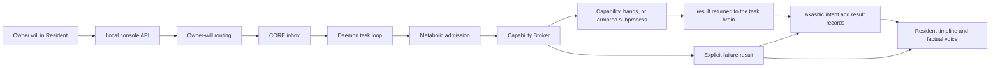

# ELORA Grand Practical Blueprint

- **Snapshot date:** 2026-10-14
- **Evidence window:** 2026-10-13 live Brave run and its recorded follow-up
- **Runtime commit:** `5a16f41`
- **Prior documentation commit:** `4e76f9a`

This blueprint connects ELORA's architecture to actions that were actually performed, the evidence they produced, and work that still needs practical acceptance. A passing automated suite is recorded separately from a live UI or runtime check. The detailed measurements and raw category rationale are in the [practical audit](ELORA_PRACTICAL_AUDIT_2026-10-13.md).

## 1. Verified snapshot

| Area | Evidence | Status |
|---|---|---|
| Desktop Resident UI | Opened and operated in the existing Brave instance. Wills list expanded from 12 to 50 and collapsed; Daily Briefing opened; no horizontal overflow was seen. | **Live desktop check passed** |
| Owner greeting | Submitted `Hlo` in Resident. Task finished `DONE_NO_WORK`; UI said, “Hello. I'm here. What would you like me to do?” | **Live check passed** |
| Read-only execution | Resident requested `git.status`; daemon and Broker completed it with `rc=0` and linked lifecycle evidence. | **Live check passed** |
| Akashic chain | Verification returned `(True, None)` at sequence 7656. | **Live integrity check passed** |
| Test suite | `pytest tools/tests`: 285 passed, 13 warnings, 135.74 seconds. | **Automated suite passed** |
| Preflight and smoke | `run.py --check`: 0 failures, 4 warnings. `run.py --smoke`: GREEN. | **Automated checks passed** |
| Screen capture | Real Resident `screen.capture` failed with `rc=1: screen grab failed`; the error was shown instead of an invented image. | **Blocked; fail-closed behavior verified** |
| Desktop UI score | 9.0/10 for the reviewed desktop Brave viewport. Mobile, keyboard-only, and screen-reader acceptance remain untested. | **Narrowly scoped score** |
| Overall practical score | 8.1/10 across 13 reviewed areas. | **Not a production-readiness certification** |

## 2. Request-to-evidence path



The acceptance rule is: a capability result must return to the brain, be recorded, and be presented truthfully. A successful process return code is not by itself proof that every invariant was audited. `/api/chat` remains talk-only; tool execution enters through the Resident inbox and CORE Broker path.

## 3. Practical operator walkthrough

Run these from the repository root. The October 13 measurements below describe one Windows machine; repeat them after meaningful runtime or UI changes.

### A. Check the environment and task loop

```bash
python run.py --check
python run.py --smoke
pytest tools/tests
```

Recorded outcome: 0 preflight failures and 4 environment warnings; smoke GREEN; 285 tests passed with 13 warnings. The full dependency set includes heavyweight local-generation packages; inspect `requirements.txt` before installing on a metered connection.

### B. Start and open Resident

For an operator-started console and resident:

```bash
python run.py --resident --brain bitnet
```

Open `http://127.0.0.1:8765/` in Brave and select Resident. When launched through the Tauri shell, Tauri starts the console server and resident sidecar itself; do not start a second `--resident` server.

### C. Check the desktop UI controls

1. Confirm the dashboard renders and the Resident, Ledger, Genome, Registry, Router, and Not wired navigation appears.
2. In Recent Wills, confirm the compact `12 of 50` view. Expand all 50, then collapse it again.
3. Select Daily Briefing. In the audited run it opened the Memory deck and showed the actual ledger summary: 0 pages read, 0 documents ingested, and 13 skills crystallized in the previous 24 hours.
4. Check the tested desktop layout for readable task traces and horizontal overflow. The recorded Brave view passed these checks; responsive and assistive-technology checks are still open.

### D. Check truthful no-work behavior

1. Submit `Hlo` in Resident.
2. Confirm the task can finish as `DONE_NO_WORK` without claiming that an organ ran.
3. Confirm the response is `Hello. I'm here. What would you like me to do?`
4. Confirm no generic “ELORA online” success filler replaces the real task outcome.

This is a greeting acceptance check, not proof of tool execution.

### E. Check one harmless tool execution

1. Ask Resident for a read-only workspace status.
2. Confirm the user will is queued and started.
3. Confirm a capability intent and Broker result exist for `git.status`.
4. Confirm the returned status is grounded in tool output and `rc=0` is shown.
5. Inspect the matching Akashic lifecycle records. Keep `invariants_audited=false` visible unless a separate invariant audit actually ran.

The October 13 run completed this path. It observed `main` and 125 then-changed paths; that count was a snapshot before the later commits.

### F. Exercise the perception failure path

Invoke Resident's “See Screen” action. In the audited environment, the real capture failed with `screen.capture rc=1` and `screen grab failed`. The pass criterion for failure handling is that the UI and ledger expose this failure and do not fabricate an image. Restoring a real frame is still a release blocker.

### G. Check integrity and scaling evidence

- Ledger chain: recorded full verification `(True, None)` at sequence 7656.
- Read-only scaling sample: 5 requests per worker at concurrency 1, 8, 16, and 32; all requests returned HTTP 200.
- At 32 readers, task endpoint p50 was about 22.6 ms and p95 about 542.6 ms; ledger p50 was about 62.8 ms and p95 about 528.6 ms; health p50 was about 6.0 ms and p95 about 516.2 ms.
- This is a one-host sample, not a soak test or supported capacity claim. Full endpoint measurements are in the [practical audit](ELORA_PRACTICAL_AUDIT_2026-10-13.md).

## 4. Subsystem implementation and acceptance map

| Subsystem | Main implementation | Automated coverage | Practical evidence and current limit |
|---|---|---|---|
| Resident console | `overlay/app.js`, `overlay/styles.css`, `elora/dashboard/server.py` | `tools/tests/test_overlay.py` | Live Brave desktop render and controls checked. Mobile and screen-reader behavior not tested. |
| Owner will and task loop | `elora/core/owner_will.py`, `elora/daemon.py` | `test_chat_loop.py`, `test_control_loop.py`, `test_resident_maid.py` | Live greeting and read-only will checked. Long-running multi-step owner task acceptance remains broader than this read-only sample. |
| Broker and hands | `elora/core/broker.py`, `elora/slime/hands.py` | `test_broker.py`, `test_hands.py`, plus control-loop tests | Live `git.status` returned `rc=0`; no destructive task was attempted. |
| Akashic evidence | `elora/organs/akashic.py` | `test_ledger_reader.py`, `test_akashic_concurrency.py` | Chain verified; live task lifecycle evidence observed. |
| Metabolism and telemetry | `elora/core/metabolism.py`, `elora/core/system_metrics.py` | `test_metabolism.py`, `test_proactive_telemetry.py`, `test_reactor.py` | Live RAM reading was about 14.7% headroom. Long-duration resource stability not measured. |
| Proactive behavior and specialists | `elora/core/proactive.py`, `elora/slime/specialists.py` | `test_proactive_telemetry.py` and full suite | Automated coverage passed; no separate long-running proactive workflow was accepted live in this audit. |
| Router/provider | `elora/brain.py`, `elora/dashboard/server.py` | Full suite plus live provider requests | Catalog reported 971 models; exact-output responses took 18.1 seconds and 14.3 seconds. Broad failover and reliability were not tested. |
| Registry/discovery and plugins | `elora/core/discovery.py`, `elora/slime/plugin_adopt.py` | `test_plugin_adopt.py` and full suite | Live scan was indexed and paginated but truncated; plugin loader unavailable in that run. |
| Screen capture/control | `elora/slime/computer_use.py` | `test_computer_use.py` | Capture attempted through the actual Resident path and failed. `screen.control` was not exercised live. |
| Windows process/security membrane | `elora/core/armored_subprocess.py`, `elora/slime/sandbox.py` | `test_armored.py`, `test_sandbox.py` | Jailed smoke checks passed. POSIX `RLIMIT_FSIZE` is unavailable; Windows Job Object limits and tier restrictions remain. This is not a full security audit. |
| Genome and theme | `elora/core/aesthetic.py`, overlay theme rendering | `test_overlay.py` and full suite | Seven displayed contrast floors passed; v14 active. v15/v16 need visual comparison before adoption. |
| Tauri shell | `src-tauri/src/main.rs`, `src-tauri/tauri.conf.json` | `test_tauri.py` | Preflight and automated checks passed; a separate end-to-end Tauri desktop session was not part of the Brave audit. |
| Voice, browser, ingestion, generation | `elora/slime/voice.py`, `browser.py`, `ingest.py`, `generation.py` | `test_voice.py`, `test_browser_and_ingest.py`, `test_generation.py` | Automated suite passed. Their complete live end-to-end user workflows were not exercised in this audit. |
| Native and WASM components | `native/bitnet/`, `elora/core/wasm_gastric.py`, `elora/core/virtio_shm.py` | `test_bitnet.py`, `test_wasm_gastric.py`, `test_virtio_shm.py` | Preflight checks passed on the audited host. Sustained load and packaged release acceptance remain separate work. |

## 5. Release gates still open

These are concrete completion checks, not claims that the work is already done:

1. **Restore screen capture:** make the live Windows `PIL.ImageGrab.grab()` path return a real frame; verify the frame in UI and match it to the ledger result.
2. **Define Windows file-size containment:** replace the missing POSIX `RLIMIT_FSIZE` control with an effective Windows limit and test boundary cases before enabling higher tiers.
3. **Reduce latency tails:** profile concurrency 16–32 p95 spikes, rerun the same endpoint sample, then complete a longer soak with a documented limit.
4. **Finish Registry:** establish bounded scan behavior, remove or clearly expose truncation, and make the plugin loader available or report its precise limitation.
5. **Review Genome generations:** compare v14, v15, and v16 in the actual UI and record the decision and contrast results.
6. **Complete UI acceptance:** test narrow desktop/mobile widths, keyboard-only navigation, and screen-reader announcements.
7. **Exercise Tauri end-to-end:** launch the packaged shell, verify server/sidecar startup, run a harmless Resident will, and match the result to Akashic evidence.
8. **Exercise remaining organs live:** run bounded, harmless voice, browser, ingestion, and generation workflows where their required hardware/services are available; document unavailable dependencies as unavailable.
9. **Recheck provider behavior:** repeat exact-output calls and test bounded failover; record live catalog and timing instead of treating a model count as permanent.

## 6. Git and completion state

- Runtime implementation, tests, audit, skill artifacts, and helper scripts are in `5a16f41`.
- README and audit follow-up are in `4e76f9a`.
- At the start of this blueprint follow-up, the last verified local state was `main` aligned with `origin/main` at `4e76f9a`; this blueprint is the next documentation change.
- The local pytest cache and copied third-party checkout tree under `scratch/stolen_repos/` remain untracked and were excluded. They are not ELORA source deliverables.
- GitHub reported that direct pushes to `main` bypassed its pull-request-required rule.

The source and documentation deliverables are committed. The practical project is **not complete** until the open release gates above are closed and accepted with fresh evidence.
