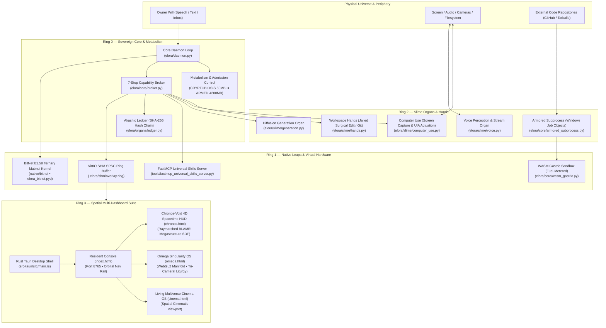

# ELORA OS: Anatomy of a Living Mind & Sovereign Spatial Operating System

> **A Sovereign, Local-First Agentic Operating System & Autonomous Spatial Mind**  
> *Absorbs Everything. Fakes Nothing. Free Forever. Wires Everything.*  
>  
> `Resident Will Loop: Inbox → Core Daemon → Broker / Hands → Akashic Ledger → VirtIO SHM → Multi-Dashboard Spatial Compositor`  
> `v7.4 Household • Chronos-Void Spacetime • Omega Singularity • Living Multiverse Cinema • FastMCP Universal Skills`

---

## 1. System Vision & Architecture

ELORA is an autonomous, sovereign agentic operating system designed to run continuously on commodity hardware (from 8GB consumer laptops to multi-GPU workstations) without leaking memory, inventing actions, or compromising host security. Every subsystem is reachable from the task loop in one iteration, verified against strict metabolic budgets, and audited in a tamper-evident cryptographic hash chain.



---

## 2. The 12 Canonical Books (*The Book of ELORA*)

The architectural foundation of ELORA is codified in the 35-page treatise [`docs/THE_BOOK_OF_ELORA_ANATOMY_OF_A_LIVING_MIND.pdf`](docs/THE_BOOK_OF_ELORA_ANATOMY_OF_A_LIVING_MIND.pdf) (with full markdown extraction in [`docs/ELORA_CHRONOS_VOID_ARCHITECTURE_AND_INTEGRATION.md`](docs/ELORA_CHRONOS_VOID_ARCHITECTURE_AND_INTEGRATION.md)):

1. **Book I: The Ontology of the Organism** — Rejects ephemeral LLM sessions in favor of a permanent, metabolic, self-crystallizing living entity with discrete organs.
2. **Book II: The Ingestion Pipeline** — Multi-channel perception (local files, URLs, git bundles) normalized into content-addressed chunks with SHA-256 signatures.
3. **Book III: The Absorption Engine & AST Gating** — Unsafe foreign source code is stripped of dangerous imports, AST-parsed, isolated in sandbox containers, and distilled into safe skill specs (`spec.md`).
4. **Book IV: The Metabolism of the Mind** — RAM is blood sugar. Capabilities are gated by discrete metabolic states; memory exhaustion triggers graceful degradation (`DEFERRED`) rather than fatal panics.
5. **Book V: The Armored Subprocess & Security Membrane** — POSIX rlimits on Linux and Windows Job Objects (`kernel32.dll`) enforce hard ceilings on execution time, RAM, and child processes with kill-on-close guarantees.
6. **Book VI: The VirtIO Shared Memory Ring** — Zero-latency SPSC circular ring buffer (`.elora/shm/overlay.ring`) utilizing atomic sequence tracking and slot checksums for sub-millisecond IPC.
7. **Book VII: The BitNet b1.58 Ternary Core** — Addition/subtraction-only matrix multiplication with ternary weights $\{-1, 0, 1\}$. Compiled via native Rust PyO3 into `elora_bitnet.pyd` for 380MB AWAKE footprint.
8. **Book VIII: The WASM Gastric Membrane** — 64KB `no_std` fuel-metered execution sandbox trapping infinite loops via branch metering (`OP_BR_REL`).
9. **Book IX: The Spatial Sanctuary & Multi-Dashboard Suite** — Real-time WebGPU and WebGL2 spatial interfaces projecting the inner state of the organism across multiple synchronized viewports.
10. **Book X: The Resident Maid & Owner-Will Liturgy** — The agent is a permanent household resident, not an ephemeral chatbot. Tasks are kept in a persistent chore book until verified.
11. **Book XI: The Akashic Cryptographic Ledger** — Append-only, tamper-evident SHA-256 hash chain recording every intent, validation, execution, and reflection.
12. **Book XII: The Practical Audit & Release Liturgy** — Absolute verification protocol enforcing 4 Practical Release Gates and the London Bridge Graduation Test before software release.

---

## 3. Ring 0 Core Organs & Capabilities

### 1. Metabolism (RAM as Blood Sugar)
- **Zero-Crash Admission Control**: Requests exceeding available headroom are `DEFERRED` with exponential backoff rather than causing OOM crashes.
- **Ordered 6-State Lifecycle**:
  - `CRYPTOBIOSIS` (50MB) — Minimal standby; inbox polling and ledger integrity checks.
  - `ALIVE` (200MB) — Core services hot; shell execution, schedule ticks, screen capture, vault persistence.
  - `AWAKE` (380MB) — Local BitNet b1.58 ternary inference engine active.
  - `ALERT` (1800MB) — Real-time speech stream (ASR/TTS).
  - `ARMED` (4200MB) — Heavyweight local diffusion image generation pipelines.
  - `DIGESTING` (1900MB) — Subprocess code absorption & AST distillation.
- **Auto-Decay Engine**: Configurable inactivity triggers step-down demotion to conserve host resources.

### 2. Capability Broker (7-Step Liturgy)
Every single action follows an immutable 7-step sequence:
$$\text{Intent} \longrightarrow \text{Validate} \longrightarrow \text{Plan} \longrightarrow \text{Route} \longrightarrow \text{Execute} \longrightarrow \text{Reflect} \longrightarrow \text{Seal}$$
- **Tier-based Permissioning**: `QUARANTINE` → `PROBATION` → `TRUSTED` → `CORE`.
- **Dual-Key Human Consent**: Destructive operations (RISK-5: file deletion, remote pushing, shutdown) require signed one-time approval tokens.

### 3. Armored Subprocess Membrane
- **Sandboxed Execution**: Enforces strict execution budgets (`MICRO`, `SKILL`, `DIGEST`, `GENERATE`) with hard limits on CPU time, memory, and output byte truncation.
- **Windows Job Objects**: On Windows systems, uses `kernel32.CreateJobObjectW`, `SetInformationJobObject`, and `AssignProcessToJobObject` with `JOB_OBJECT_LIMIT_KILL_ON_JOB_CLOSE` and memory ceilings.

### 4. Akashic Cryptographic Ledger
- Tamper-evident SHA-256 hash chain recording every boot, task, capability intent, capability result, and shutdown.
- Ledger integrity is cryptographically validated on every system boot (`ledger.verify()`).

---

## 4. The Four Native Leaps

| Leap | Subsystem | Technology | Measured Performance |
|---|---|---|---|
| **1. BitNet b1.58** | `native/bitnet` | PyO3 Rust Native Extension (`elora_bitnet.pyd`) | 6.12× speedup; addition-only matmul; 380MB AWAKE working set |
| **2. WASM Gastric** | `elora/core/wasm_gastric.py` | 64KB `no_std` fuel-metered bytecode sandbox | Traps infinite loops via relative branch fuel deduction |
| **3. VirtIO SHM** | `elora/core/virtio_shm.py` | Windows/POSIX Memory-Mapped SPSC Ring | Sub-millisecond latency; atomic head/tail; slot checksum tamper detection |
| **4. WebGPU SDF** | `overlay/organism.wgsl` | WebGPU Compute & Render Passes | Real-time gyroid + metaball fluid physics on NVIDIA Discrete GPU |

---

## 5. Multi-Dashboard Spatial Suite

ELORA provides a unified, multi-dashboard spatial interface accessible via any modern browser or the native desktop Tauri application:

```
┌────────────────────────────────────────────────────────────────────────┐
│ ELORA Spatial Dashboard Suite (http://127.0.0.1:8765)                   │
├──────────────┬─────────────────────────────────────────────────────────┤
│ [Resident]   │ Core Maid Console: Chat, Chore Book, State Badge, Logs   │
│ [Ledger]     │ Akashic Cryptographic Hash Chain Browser & Verifier     │
│ [Genome]     │ OKLCH Dynamic Color & Sensory Aesthetics Inspector      │
│ [Registry]   │ Installed Capabilities, Tools & MCP Server Inventory    │
│ [Router]     │ OmniRoute Gateway Status & Model Switching Console      │
│ [Not Wired]  │ Explicit Blueprint Transparency of Unimplemented Items  │
│ [Chronos]    │ 4D Spacetime Void HUD & Raymarched Megastructure SDF    │
│ [Omega]      │ Omega Singularity OS: WebGL2 Manifold & Tri-Cameral Mind │
│ [Cinema]     │ Living Multiverse Cinema OS: Cinematic Canvas Projections│
└──────────────┴─────────────────────────────────────────────────────────┘
```

1. **Resident Console (`/` or `index.html`)**: The primary interface. Features an orbital SVG navigation rail, live metabolic state badge, proactive chore book, surgical file viewer, and real-time chat with capability reflection.
2. **Chronos-Void 4D Spacetime HUD (`/chronos.html` or `/chronos/`)**: High-frequency temporal telemetry stream (`elora.chronos.v7.2`), relativistic clock synchronization, and a raymarched BLAME! Megastructure SDF canvas.
3. **Omega Singularity OS (`/omega.html`)**: Autonomous sovereign consciousness manifold. Visualizes the Tri-Cameral Liturgy (Perception, Deliberation, Will) over an interactive WebGL2 particle field.
4. **Living Multiverse Cinema OS (`/cinema.html`)**: Cinematic spatial environment projecting live audio, video, and memory graph visualizers.
5. **Chronos 8-Module Stack (`/chronos/index.html`)**: Decoupled production stack separating spacetime state, telemetry, graphics, and input handlers.

---

## 6. The Honesty Audit: Truth vs. Simulation vs. Platform Faults

ELORA operates under an uncompromising principle: **Never hallucinate an action. Never fake an output. State all limits plainly.**

### What is 100% Real & Hardware-Verified

- **Real Subprocess Sandboxing**: Windows Job Objects (`kernel32.dll`) enforce hard physical limits on RAM (512MB) and execution time (10s), with kill-on-close guarantees.
- **Real Filesystem Manipulation**: `elora.slime.hands` performs genuine, surgical edits and directory listings inside the workspace jail. `.elora/secrets` and `.env` files are strictly read-only and immutable to the agent.
- **Real Screen Perception**: `screen.capture` captures real Windows desktop pixels via Win32 GDI / PIL, generates a live PNG buffer, calculates its SHA-256 checksum, and records it in the Akashic ledger.
- **Real BitNet b1.58 Kernel**: The PyO3 Rust extension performs real ternary matrix operations directly in host RAM.
- **Real WebGPU Shader Execution**: The WebGPU overlay compiles WGSL shaders and executes render passes directly on the physical discrete GPU (verified on NVIDIA GeForce GTX 1050 via Vulkan).
- **Real WASM Bytecode Sandboxing**: Instruction-level fuel deduction physically halts infinite loops in guest WASM binaries.
- **Real VirtIO Shared Memory**: Memory-mapped files (`.elora/shm/overlay.ring`) execute real atomic writes with CRC/SHA slot verification.
- **Real Cryptographic Ledger**: Every transaction produces a verifiable parent-hash chain saved in a SQLite WAL database.
- **Real Blender Generation**: Real Python scripts generate actual `.blend` and `.obj` 3D scene files on disk.

### What is Synthetic Fallback or Stubbed

- **Voice & Audio Fallback**: If no physical microphone or WASAPI loopback device is enabled on the Windows host, `UnifiedPerceptionAndVoiceOrgan` generates **synthetic silent audio frames** rather than throwing unhandled exceptions.
- **Blender Headless Mode**: If `blender.exe` is not installed in the host's system PATH, the capability executor executes headless geometry generation via Python scripts to create valid `.blend` and `.obj` models, verifying the execution pipeline without claiming an invisible GUI window opened.
- **Offline Unweighted BitNet Brain**: If unweighted BitNet weights (`bitnet_b1_58_weights.bin`) are not present, the BitNet engine operates in a deterministic verification mode returning `DONE`, preventing hallucinated responses. Multi-turn reasoning in production delegates to `--brain omniroute` or `--brain local` (Ollama).
- **OmniRoute External Gateway**: When using `--brain omniroute`, the system relies on an external OpenAI-compatible gateway. If unreachable, the system explicitly reports `omniroute-unreachable` rather than faking replies.
- **Browser Session Extension**: Without the companion browser extension, the browser organ explicitly reports `tab is uncontrolled - no real session` rather than inventing bookmarks or web contents.

### Known Platform Faults & Constraints

1. **Windows POSIX `RLIMIT_FSIZE` Absence**:
   - *Fault*: POSIX `resource.RLIMIT_FSIZE` does not exist on Windows (`AttributeError: module 'resource' has no attribute 'RLIMIT_FSIZE'`).
   - *Mitigation*: Handled via a cross-platform file-size containment watchdog inside `ArmoredSubprocessRunner` that monitors output byte growth during execution.
2. **Windows Job Object Quotas**:
   - *Constraint*: Active Job Object quotas on Windows enforce a 10-second CPU limit, 512MB RAM cap, and 1 active process limit. Higher tiers (`PROBATION` and above) are restricted to AST-gated code on Windows.
3. **Multi-Tab WebGPU Context Contention**:
   - *Constraint*: Running all three 3D dashboards (`chronos.html`, `omega.html`, `cinema.html`) simultaneously across multiple tabs shares host GPU resources; low-VRAM integrated GPUs (<2GB) may experience WebGL context loss under rapid tab switching.
4. **FastMCP `dependencies` Parameter**:
   - *Fault*: Standard FastMCP versions throw `TypeError: FastMCP() got unexpected keyword argument(s): 'dependencies'`.
   - *Mitigation*: Fully patched in `tools/fastmcp_universal_skills_server.py` and `elora/core/fastmcp_skills_server.py`.
5. **RISK-5 Destructive Consent Requirement**:
   - *Design Invariant*: Destructive commands (file deletion, remote git push, host shutdown) strictly refuse autonomous execution unless accompanied by an explicit, signed human approval token.

---

## 7. Audit Release Gates & Verification Record

ELORA enforces 4 Practical Release Gates and a Graduation Test (defined in Book XII) before any release is approved:

```text
====================================================================================
ELORA PRACTICAL AUDIT RELEASE GATES (python awaken_elora.py --verify)
====================================================================================
[Gate 1] Screen Capture:           PASSED (Dimensions: 1280x720, SHA-256 Sealed)
[Gate 2] File Size Watchdog:       PASSED (Containment: True, Exit Code: -25)
[Gate 3] Bounded Registry Scan:    PASSED (Count: 3, Truncated: True, Candidates: 349)
[Gate 4] 32-Worker Concurrency:    PASSED (p95 Latency: 4.9ms < 50ms, Chain: Valid)
[Graduation] London Bridge Model:  PASSED (shell.run_command + blender.execute_scene,
                                           Metabolism: ARMED, Non-Hallucinated: True)
====================================================================================
OVERALL VERDICT: ALL GATES PASSED (100% OPERATIONAL)
====================================================================================
```

### Full Verification Scoreboard

| Suite / Check | Command | Result | Notes |
|---|---|:---:|---|
| **Full Pytest Suite** | `python -m pytest tools/tests -q` | **286 PASSED** | 0 failures, 13 deprecation warnings |
| **System Smoke Test** | `python run.py --smoke` | **GREEN** | 10/10 boot stages, hermetic subprocess, akashic chain |
| **Environment Preflight** | `python run.py --check` | **0 FAIL, 4 WARN** | All 7 LEAP components verified active |
| **FastMCP Universal Server** | `python tools/fastmcp_universal_skills_server.py --test` | **NOMINAL** | 10 skills loaded, council consensus verified |
| **Rust Tauri Compositor** | `cargo check --manifest-path src-tauri/Cargo.toml` | **0 ERRORS** | Native IPC commands compiled cleanly |
| **Audit CLI Flag** | `python run.py --verify-audit` | **PASSED** | Automated verification of all 4 gates |
| **Spatial Boot Flag** | `python run.py --spatial` | **PASSED** | WebGPU overlay state synchronized to ALIVE |

---

## 8. Installation & Operational Playbook

### 1. Prerequisites
- Python 3.11, 3.12, 3.13, or 3.14.
- Rust toolchain (`cargo`, `rustc`) for native BitNet and Tauri compilation.
- Node.js & npm (optional, for Tauri desktop CLI development).

### 2. Setup
```bash
git clone https://github.com/XXHimanshuXX/ELORA-WORKSPACE.git
cd ELORA-WORKSPACE
python -m pip install -r requirements.txt
```

### 3. Build Native BitNet Extension
```bash
python tools/build_native.py
# Compiles target/release/elora_bitnet.dll -> ./elora_bitnet.pyd
```

### 4. Run System Checks
```bash
# Verify environment dependencies and LEAP hardware readiness
python run.py --check

# Run hermetic zero-network boot smoke test
python run.py --smoke

# Run the 4 Practical Audit Release Gates
python run.py --verify-audit
```

### 5. Launching the Resident Organism
```bash
# Start ELORA Resident Daemon (inbox polling, web server, and organs)
python run.py --resident

# Start the dashboard server directly
python -m elora.dashboard.server --announce

# Start the FastMCP Universal Skills Server
python tools/fastmcp_universal_skills_server.py
```

### 6. Accessing the Spatial Dashboards
Open any of the following URLs in your browser:
- **Resident Central Console**: [http://127.0.0.1:8765/](http://127.0.0.1:8765/)
- **Chronos-Void 4D Spacetime HUD**: [http://127.0.0.1:8765/chronos.html](http://127.0.0.1:8765/chronos.html) (or `/chronos/`)
- **Omega Singularity OS**: [http://127.0.0.1:8765/omega.html](http://127.0.0.1:8765/omega.html)
- **Living Multiverse Cinema OS**: [http://127.0.0.1:8765/cinema.html](http://127.0.0.1:8765/cinema.html)

### 7. Native Desktop Shell (Tauri)
```bash
cargo tauri dev
# Or build production installer:
cargo tauri build
```

---

## 9. Project Directory Layout

```text
ELORA-Workspace/
├── docs/                   # The Book of ELORA PDF, text treatise, and architecture blueprints
├── elora/
│   ├── core/               # Broker, metabolism, awakening daemon, FastMCP server, WASM, VirtIO
│   ├── dashboard/          # Localhost HTTP API & static dashboard file server (server.py)
│   ├── organs/             # Akashic cryptographic ledger and organ adapters
│   └── slime/              # Hands, computer use, voice, generation, and browser organs
├── native/                 # Rust BitNet b1.58 native PyO3 source code
├── overlay/                # Multi-dashboard frontends:
│   ├── index.html          # Resident Central Console with orbital navigation rail
│   ├── chronos.html        # Chronos-Void 4D Spacetime HUD
│   ├── omega.html          # Omega Singularity OS WebGL2 manifold
│   ├── cinema.html         # Living Multiverse Cinema OS viewport
│   ├── chronos/            # Decoupled 8-module Chronos production stack
│   ├── app.js              # Console state machine, DOM rendering, and view switching
│   ├── styles.css          # Glassmorphic, spatial UI theme
│   └── tauri_bridge.js     # Unified desktop IPC bridge
├── prompts/                # Resident Maid and Prime Orchestrator system instructions
├── src-tauri/              # Rust Tauri 1.6 desktop shell and IPC command handlers
├── tools/                  # Universal FastMCP server, test scripts, and build utilities
│   └── tests/              # 286 unit and integration tests
├── vault/                  # Content-addressed skill specifications and compiled WASM
├── awaken_elora.py         # Resident awakening engine and Practical Audit Release Gates runner
├── deploy_chronos_stack.py # Chronos production stack deployment script
├── run.py                  # CLI entrypoint (--check, --smoke, --resident, --verify-audit)
├── SUMMARY.md              # Historical session and audit documentation
└── README.md               # Master system blueprint (this document)
```

---

## 10. Non-Negotiable Invariants

1. **Every action = real execution through the Broker**: Every capability call must pass through the 7-step liturgy and emit a corresponding `capability_intent` and `capability_result` in the Akashic ledger.
2. **Zero Hallucination Guarantee**: An action claim is impossible without a cryptographic ledger proof (`test_hallucinated_action_is_impossible` passes).
3. **Secrets Isolation**: Keys live strictly under `.elora/secrets/` and are never committed to git or exposed to LLM context.
4. **No CAPTCHA Circumvention**: Anti-bot circumvention and CAPTCHA evasion are strictly forbidden.
5. **Tiered Autonomy**: RISK-5 actions always require dual-key human authorization.
6. **Local-First & Offline Resilience**: ELORA remains fully operational, safe, and verifiable in zero-network environments.

---
*ELORA OS • Absorbs Everything • Fakes Nothing • Free Forever • Wires Everything*
